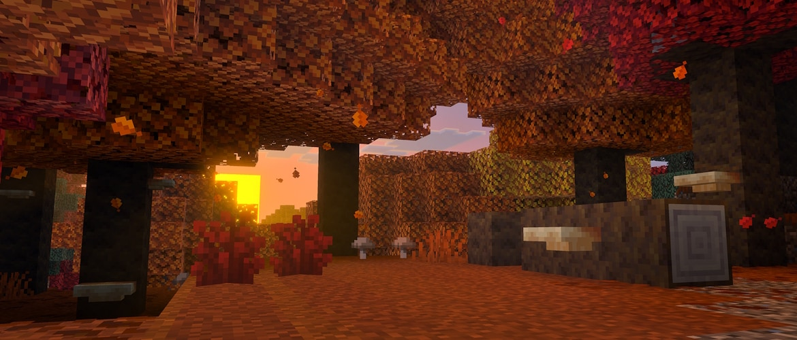
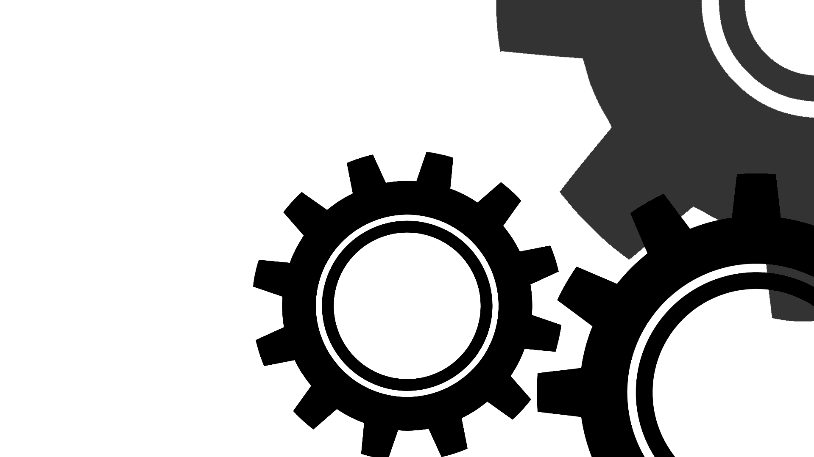

<h1 align="center" style="font-size: 32px"># Eduardo Bissoli #</h1>
 

Criador da comunidade Minecraft bedrock com a criação de addons e contribuição para novas implementações sempre que possível

• Criador de addons ( futuramente quero buscar o MarketPlace )
 
• Bibliotecas já criadas como a rustRock que baseava a criação de addons na linguagem rust

 
 
 
<h1 align="center">Developer Rust e Web</h1>

Alem disso, tambem passo meu tempo criando ferramentas em rust e paginas web quando necessário, fique a vontade para olhar meus repositórios !

 

 
 
<h1 align="center">Informações adicionais</h1>

<strong>
• Arch Linux User 🐧
 
• Desenvolvedor ativo 💡
 
• Area Web ( html, css, js, ts, jsx/tsx ) 📀
 
• Low-Level ( apenas Rust ) 💿
</strong>

